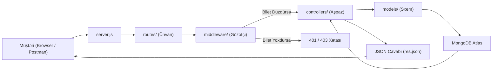

# 🚀 Backend Proqramlaşdırma Konspekti və Müsahibə Şparqalkası
> **Müəllif:** Məhəmməd Əhmədzadə  
> **Layihə:** TechStore E-Commerce RESTful API & Storefront  
> **Texnologiyalar:** Node.js, Express.js (ES Modules), MongoDB Atlas, Mongoose, JWT, Bcrypt, Render, Git.

---

## 📁 1. Layihə Qovluq Strukturu və MVC Arxitekturası

Bizim layihəmiz dünyada ən çox istifadə olunan **MVC (Model - View - Controller)** arxitekturasına əsaslanır:

| Qovluq / Fayl | Təyinatı və Rolu | Real Həyat Bənzətməsi |
| :--- | :--- | :--- |
| **`server.js`** | Layihənin giriş qapısı. Express tətbiqini başladır, qlobal middleware-ləri qoşur və müəyyən portu dinləyir. | Restoranın giriş qapısı |
| **`config/db.js`** | MongoDB Atlas verilənlər bazasına təhlükəsiz qoşulma məntiqini saxlayır. | Restoranın anbarına açılan xüsusi xətt |
| **`models/`** | Verilənlər bazasının sxemləri (User, Product, Order). Bazaya nə cür məlumatların yazılacağını müəyyən edir. | Forma və ya Şablonlar |
| **`routes/`** | API ünvanları (Endpoints). Gələn sorğunun hansı URL-ə aid olduğunu müəyyən edib müvafiq nəzarətçiyə yönəldir. | Qəbul şöbəsi / Yol göstərici lövhə |
| **`middleware/`** | Gözətçilər və filtrlər. Sorğu controller-ə çatmamışdan əvvəl icazəni və token-i yoxlayır (`gozetci`, `adminGozetci`). | Qapıdakı mühafizəçi / Bilet yoxlayan |
| **`controllers/`** | Əsas beyin və biznes məntiqi. Bazadan məlumat çəkmək, hesablamaq, cavab hazırlamaq buradadır. | Mətbəxdəki aşpaz |
| **`public/`** | Müştərinin brauzerdə gördüyü ön hissə (HTML, CSS, JavaScript vitrini). | Müştərinin oturduğu gözəl zal |
| **`.env`** | Məxfi açarlar (Baza şifrəsi, JWT_SECRET, Port). GitHub-a yüklənmir (`.gitignore`-a yazılır). | Restoranın seyfi |

---

## 🔄 2. Sorğunun Həyat Dövrü (Request Lifecycle)

Müştəri bir düyməyə basdıqda və ya Postman-dən sorğu atdıqda hadisələr bu ardıcıllıqla baş verir:

---

## 🚦 3. HTTP Metodları və Status Kodları

### Əsas HTTP Metodları (CRUD):
* **`GET`** (Read): Məlumatı oxumaq / gətirmək (məs: məhsulları siyahılamaq). Body göndərilmir.
* **`POST`** (Create): Yeni məlumat yaratmaq (məs: qeydiyyat, yeni sifariş, yeni məhsul). Body ilə göndərilir.
* **`PUT`** / **`PATCH`** (Update): Mövcud məlumatı yeniləmək (məs: sifarişin statusunu dəyişmək).
* **`DELETE`** (Delete): Məlumatı silmək (məs: məhsulu silmək).

### Ən Vacib Status Kodları (Müsahibələrdə mütləq soruşulur):
| Kod | Adı | Mənası və Nümunə |
| :--- | :--- | :--- |
| **`200 OK`** | Uğurlu | Məlumat uğurla gətirildi və ya yeniləndi. |
| **`201 Created`** | Yaradıldı | Yeni istifadəçi qeydiyyatdan keçdi və ya yeni sifariş yaradıldı. |
| **`400 Bad Request`** | Səhv Sorğu | Müştəri xanaları boş qoyub və ya səhv format göndərib. |
| **`401 Unauthorized`** | İcazəsiz Giriş | Token (bilet) göndərilməyib və ya vaxtı keçib/saxtadır. |
| **`403 Forbidden`** | Qadağandır | Token var, amma səlahiyyət çatmır (məs: adi istifadəçi admin panelinə girmək istəyir). |
| **`404 Not Found`** | Tapılmadı | Axtarılan URL və ya verilənlər bazasındakı ID mövcud deyil. |
| **`500 Internal Server Error`** | Server Xətası | Server kodunda gözlənilməz xəta baş verdi (kodda syntax və ya baza qəzası). |

---

## 🔐 4. Təhlükəsizlik Mexanizmləri: Bcrypt və JWT

### 1. Şifrələrin Qorunması (`bcryptjs`):
* **Niyə şifrələr birbaşa yazılmır?** Əgər baza sızsa, istifadəçilərin şifrələri ifşa olmasın.
* **Birtərəfli Hashing (One-way):** Şifrə xüsusi riyazi alqoritmlə qarışdırılır. Geriyə çevirmək riyazi olaraq mümkün deyil!
* **Duzlama (Salt):** Hər şifrəyə təsadüfi simvollar əlavə edilir (`bcrypt.genSalt(10)`). Nəticədə iki nəfərin şifrəsi `"123456"` olsa belə, bazadakı hash-ləri tamam fərqli görünür.
* **Login yoxlanışı:** `bcrypt.compare(gələnParol, bazadakıHash)`. Bcrypt gələn parolu həmin duzla yenidən hash-ləyir və müqayisə edir.

### 2. JSON Web Token (JWT) Necə İşləyir?
JWT 3 hissədən ibarətdir: `Header.Payload.Signature`
1. **Header:** Alqoritm məlumatı (məs: HS256).
2. **Payload:** Daşınan məlumat (məs: `{ id: user._id, role: user.role }`). **Diqqət:** Bura heç vaxt şifrə qoyulmur!
3. **Signature (İmza):** `HMACSHA256(Header + Payload, JWT_SECRET)`. Yalnız bizim serverimizin bildiyi gizli açar ilə möhürlənir!

> **Vacib Məqam:** Hacker token-i açıb içindəki `role: "user"` sözünü `role: "admin"` edərsə nə olar?  
> İmza dərhal pozulur! Server `jwt.verify()` edəndə imzanın saxta olduğunu görür və **bazaya heç sorğu göndərmədən** sorğunu 401 xətası ilə dərhal rədd edir.

---

## 🔗 5. Mongoose Əlaqələri və `.populate()`

MongoDB NoSQL bazadır (cədvəllər yerinə Kolleksiyalar var). Amma sənədlər arasında əlaqə qurmaq mümkündür:
* **`ref`:** Sxemdə başqa bir modelə işarə edir (`ref: 'User'`, `ref: 'Product'`).
* **`type: mongoose.Schema.Types.ObjectId`:** MongoDB-nin 24 simvolluq unikal identifikatorudur.
* **`.populate()`:** SQL-dəki `JOIN` əməliyyatının Mongoose qarşılığıdır. Bazada yalnız ID saxlayırıq, amma frontend-ə göstərərkən `.populate('user', 'ad email')` yazaraq həmin istifadəçinin adını və emailini avtomatik birləşdirib gətiririk.

---

## 🎯 6. Junior Backend Müsahibələrində Ən Çox Verilən TOP 5 Sual

### Sual 1: REST API nədir və əsas prinsipləri hansılardır?
> **Cavab:** REST (Representational State Transfer) müştəri ilə server arasında standart rabitə qaydaları toplusudur. Əsas prinsipləri:
> 1. **Stateless (Vəziyyətsiz):** Hər bir sorğu müstəqildir, server müştərinin əvvəlki addımını yadda saxlamır (buna görə hər sorğuda Token göndərilir).
> 2. **Client-Server ayrılığı:** Frontend və Backend bir-birindən asılı olmadan inkişaf edə bilər.
> 3. **Standart HTTP metodları:** GET, POST, PUT, DELETE istifadə olunur.

### Sual 2: Middleware nədir və `next()` funksiyası nə edir?
> **Cavab:** Middleware sorğu müştəridən çıxıb son Controller funksiyasına çatana qədər arada işləyən köməkçi funksiyalardır. Əgər hər şey qaydasındadırsa, `next()` çağırılaraq növbəti funksiyaya keçid verilir. Əgər problem varsa (məsələn token səhvdirsə), `next()` çağırılmır və dərhal xəta cavabı (`res.status(401).json(...)`) qaytarılır.

### Sual 3: Authentication (Autentifikasiya) ilə Authorization (Avtorizasiya) fərqi nədir?
> **Cavab:** 
> * **Authentication:** "Sən kimsən?" sualına cavab verir. İstifadəçinin şəxsiyyətini təsdiqləməkdir (Email və Şifrə ilə Login olub Token almaq).
> * **Authorization:** "Sənin nə etməyə icazən var?" sualına cavab verir. İstifadəçinin hüququnu yoxlamaqdır (Məsələn: adi istifadəçinin məhsul silməyə icazəsi yoxdur, yalnız `admin` silə bilər).

### Sual 4: SQL (PostgreSQL, MySQL) ilə NoSQL (MongoDB) fərqi nədir?
> **Cavab:** 
> * **SQL (Relational):** Cədvəllər, sətirlər və sərt sxemlərdən ibarətdir. Məlumatlar arasında dəqiq xarici açarlar (Foreign Keys) olur.
> * **NoSQL (Document-based):** Məlumatları elastik JSON tipli sənədlər (BSON) şəklində saxlayır. Sürətlidir, asan miqyaslanır və tez-tez dəyişən məlumat strukturları üçün idealdır.

### Sual 5: Niyə qiyməti və ya hesablama işlərini Front-end-ə etibar etmək olmaz?
> **Cavab:** Çünki Front-end (Brauzer) müştərinin kompüterində işləyir. İstənilən istifadəçi Chrome DevTools və ya Postman vasitəsilə JSON-dakı qiyməti dəyişdirib 1000 AZN-lik məhsul üçün 1 AZN göndərə bilər. Buna görə də həqiqi qiymət həmişə birbaşa verilənlər bazasından (MongoDB) oxunmalı və yekun məbləğ yalnız server tərəfində hesablanmalıdır.

---

## 🌐 7. Canlı Server və Avtomatlaşdırma (CI/CD)

* **Git & GitHub:** Kodun versiyalarını saxlayır.
* **Render.com:** Bizim bulud serverimizdir.
* **Continuous Deployment (CI/CD):** Biz terminalda `git push` edən kimi, Render dərhal GitHub-dan dəyişiklikləri çəkir, `npm install` edir və yeni versiyanı canlıya buraxır. Biz heç vaxt serverə əllə fayl köçürmürük!

